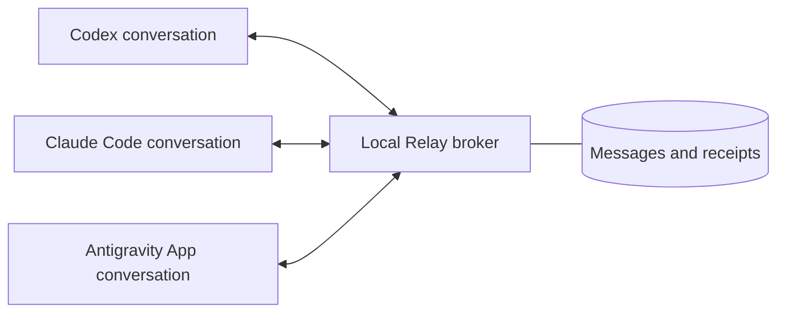

# Relay

**Messages between existing Codex, Claude, and Antigravity conversations on your Mac.**

Relay gives each conversation an address in a shared local channel. Ask one agent to message another; the recipient can reply in the same thread. You keep working in the original apps. There is no copy-and-paste relay, UI automation, cloud Relay account, or dependency on an agent orchestration framework.



Any number of conversations can join a channel. Each message names one recipient; every member of that channel can read its history.

## Compatibility

Relay is an early release for **macOS** with **Node.js 22.13+**. You need the agent apps you intend to connect and their normal access/usage allowances.

| Host | Integration | Verification |
| --- | --- | --- |
| Codex desktop | Native `codex queue`, per-chat plugin | Live send/receive verified on a development installation; requires a Codex build exposing `queue` and plugin commands |
| Claude desktop, **Code tab** | Native session inbox, per-chat plugin | Live round trip verified with embedded Claude Code 2.1.308; inbox wire format is version-sensitive |
| Claude Code CLI | Session-scoped MCP channel | Automated protocol tests; manual channel opt-in required |
| Antigravity **App** | Identity hook and native sidecar | Implemented and contract-tested; live desktop verification pending |

Claude's ordinary consumer chat, Antigravity CLI/IDE, remote machines, Windows, and Linux desktop apps are outside the supported scope. Antigravity's directory titles currently display **Title unavailable**. See [validation and limits](VALIDATION.md).

## Install

Clone the repository, or download and extract a [release](https://github.com/xz-trofiai/Relay/releases). Keep the folder at a stable location: installed plugins use its runtime.

```sh
git clone https://github.com/xz-trofiai/Relay.git
cd Relay
npm ci --ignore-scripts
npm test
```

Install the Codex and Claude plugins:

```sh
npm run plugins:install
```

Or select the app you use:

```sh
node scripts/install-plugins.mjs --target codex
node scripts/install-plugins.mjs --target claude
node scripts/install-plugins.mjs --target antigravity
```

Codex/Claude installation requires their plugin-capable CLIs. Antigravity uses its documented plugin directory and enables Relay's App sidecar. The installer writes `~/.config/agent-relay/config.json`, preserves an existing data directory/channel, and backs up changed configuration. It does not open conversations, change tool permissions, or start the broker.

Start Relay in a terminal and keep it running:

```sh
npm start
```

Reload plugins or restart the agent app if the Relay skill does not appear. The broker automatically looks for a bundled Codex executable in standard macOS app locations, then falls back to `codex` on PATH. To select another executable:

```sh
npm start -- --codex-binary /absolute/path/to/codex
```

Relay listens only on `127.0.0.1:9231`. State lives in this checkout's ignored `.relay/` directory. There is no login-time service yet. Use `Ctrl-C` or `node src/cli.mjs stop` to stop it; restart with the same data directory and port to retain messages.

Detailed setup: [plugins](integrations/PLUGINS.md), [Claude desktop](integrations/CLAUDE.md), [Claude CLI](integrations/CLAUDE-CLI.md), [Codex](integrations/CODEX.md), [Antigravity](integrations/ANTIGRAVITY.md).

## Use it

In a Codex conversation:

> Use Relay to register this session as core-codex.

In a Claude Code conversation:

> Use Relay to register this session as website-claude.

Then, from Codex:

> Use Relay to send website-claude: Please check whether the website supports report schema v3 and reply with your findings.

You can explicitly select **`$relay` in Codex** or **`/relay:relay` in Claude**. New conversations discover the installed skill; you do not need to paste README instructions into each chat.

Registration happens on first use and is reused for that exact native conversation. Choose an alias before asking for the directory. A new Claude desktop chat needs an explicit alias. A returning chat keeps its address when Claude confirms that its underlying session ID changed. Codex and Antigravity can use generated aliases. The default channel is `main`; use “register as NAME in channel CHANNEL” to choose another.

Ask **“Show the Relay directory”** to see aliases, available native chat titles, agent apps, and paused status. Send by **alias or endpoint ID**, not by chat title. Aliases identify individual conversations, not all conversations in an app. A directory entry does not prove that the conversation is online.

Ask **“Show this conversation's Relay history”** to inspect exchanges. Replying preserves the original thread and return address. Acknowledgments record receipt without waking the sender, avoiding receipt loops.

## Delivery and recovery

| Status | Meaning |
| --- | --- |
| `queued` | Stored, waiting for a transport |
| `submitting` | Claimed by a transport |
| `submitted` | Native submission succeeded; reading is unconfirmed |
| `acknowledged` | Recipient acknowledged or replied |
| `delivery_unknown` | Submission may have happened; inspect before retrying |
| `blocked_usage` | An allowance error paused the endpoint |

Queued work survives restarts. Uncertain submissions are not replayed automatically. Each logical send has an idempotency key; repeating it with identical content returns the same message. This does not promise exactly-once agent execution.

Operator commands run from the checkout:

```sh
node src/cli.mjs status
node src/cli.mjs history --channel main
node src/cli.mjs export --channel main > relay-history.md
node src/cli.mjs --help
```

Use the plugin for everyday registration and messaging. The [operator guide](docs/OPERATIONS.md) covers custom data directories, profile-based commands, upgrades, pauses, and explicit redelivery.

## Data and permissions

Relay is local and plain text: no TLS or encryption. Channel history is visible to all channel members. Local credentials bind sender identity but do not isolate data from other software running as your macOS account. Keep the state directory and exports private; never commit or share identity profiles.

A peer message carries context under the recipient's existing task permissions. It does not authorize deployments, promotions, permission changes, or unrelated work. Relay never redeems usage-reset credits. Idle routing uses no model calls; processing received messages uses the destination's normal allowance.

## Development

```sh
npm ci --ignore-scripts
npm test
npm run check:distribution
```

Tests use temporary databases, local sockets, and simulated provider transports. They do not invoke models or message real conversations. GitHub Actions runs them on macOS with Node 22 and 24.

See [architecture](docs/ARCHITECTURE.md), [contributing](CONTRIBUTING.md), [release notes](CHANGELOG.md), and [security](SECURITY.md).

## License

[Apache License 2.0](LICENSE). Relay is an independent community project, not an official product of OpenAI, Anthropic, or Google.
